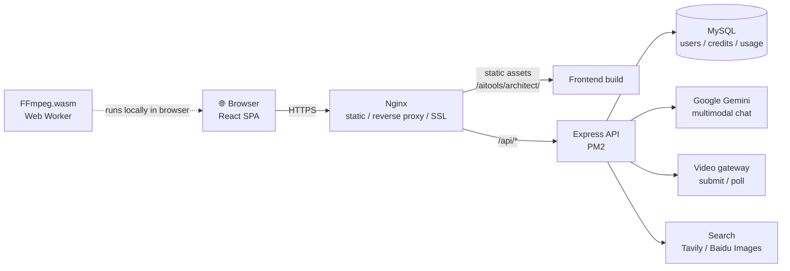

<div align="center">


# Chief Image Architect

**An all-in-one AI visual creation studio — chat, image generation and video in one workspace**

[简体中文](README.md) ｜ English

<br />


</div>

---

**Chief Image Architect** is an AI visual creation studio for content creators. It unifies
multimodal chat, AI image generation/editing and AI video generation in one elegant dark-themed
workspace. Image EXIF watermarking and in-browser FFmpeg video watermarking protect copyright,
while invite codes, credit plans and an admin dashboard provide a complete commercial platform.

## 📸 Preview

<div align="center">

</div>

| Image Generation & Editing | AI Video Director |
| :---: | :---: |
|  |  |

> More screenshots in [`DOCS/images/`](DOCS/images/).

## 📑 Table of Contents

- [Highlights](#-highlights)
- [Tech Stack](#-tech-stack)
- [Quick Start](#-quick-start)
- [Project Structure](#-project-structure)
- [System Architecture](#-system-architecture)
- [Environment Variables](#-environment-variables)
- [Deployment](#-deployment)
- [Roadmap](#-roadmap)
- [FAQ](#-faq)
- [License](#-license)

## ✨ Highlights

### 🎨 Image Architect
- **AI image generation**: text-to-image and image-to-image with stylized prompts
- **Inpainting**: brush over any area and regenerate just that part
- **Screenshot cropper**: capture and crop source material without leaving the app
- **Style transfer**: migrate the style of a reference image in one click
- **Copyright watermark**: EXIF metadata plus visible watermark via `piexifjs`

### 💬 AI Chat
- Multimodal conversation powered by **Google Gemini** (`@google/genai`)
- **Web-enhanced answers**: Tavily (global) and Baidu Image Search (China) channels
- Image understanding with one-click hand-off to image / video modules

### 🎬 Anime Director Console
- **AI video generation**: task submission via the backend gateway, polling and auto-recovery
- **In-browser processing**: `FFmpeg.wasm` + Web Worker adds video watermarks with zero server cost
- Persisted results auto-restore from the server after refresh or tab switches

### 🏢 Platform
- Invite-code registration, JWT auth, password reset
- Credit / plan billing, usage analytics, online payment
- Beta application review and a standalone admin dashboard

## 🛠 Tech Stack

| Layer | Technologies |
| --- | --- |
| Frontend | React 19, TypeScript 5.8, Vite 6 |
| State & Styling | Redux Toolkit, Tailwind CSS 4, lucide-react |
| In-browser | FFmpeg.wasm, Web Worker, piexifjs, Canvas / Blob |
| AI | Google Gemini (`@google/genai`), third-party video gateway |
| Backend | Node.js (≥18), Express, MySQL 5.7+, PM2 |
| DevOps | Nginx reverse proxy, Let's Encrypt SSL, BT Panel |

## 🚀 Quick Start

### Prerequisites

- Node.js ≥ 18
- npm ≥ 9 (or equivalent pnpm / yarn commands)
- MySQL 5.7+ (only needed to run the backend locally)

### Frontend

```bash
# 1. Install dependencies
npm install

# 2. Start the dev server (http://localhost:3000/aitools/architect/)
npm run dev

# 3. Type check
npm run lint

# 4. Production build (outputs to dist/)
npm run build

# 5. Preview the production build locally
npm run preview
```

> In development all API requests go through the Vite dev proxy, so the frontend works without
> running the backend locally. See `server.proxy` in [`vite.config.ts`](vite.config.ts).

### Backend (optional)

```bash
cd backend
npm install
cp .env.example .env   # fill in the variables below
mysql -u root -p < database.sql   # import schema
npm start              # or with PM2: pm2 start ecosystem.config.js
```

## 📂 Project Structure

```
.
├── App.tsx                  # App entry, orchestrates the three modules
├── index.tsx                # React mount
├── components/              # UI components (image, inpaint, video, chat...)
├── services/                # Business services (AI, watermark, API, usage, video...)
├── src/
│   ├── store/               # Redux Toolkit store (slices)
│   ├── hooks/               # Custom hooks
│   ├── config/              # Plan and other frontend config
│   └── styles/              # Global styles
├── legal/                   # Privacy policy & terms of service
├── i18n/                    # Locale strings
├── vite.config.ts           # Vite build & dev proxy config
├── backend/                 # Express backend
│   ├── server.js            # Server entry
│   ├── routes/              # Routes (auth, video gateway, payment, usage...)
│   ├── controllers/         # Controllers
│   ├── services/            # Service layer
│   ├── middleware/          # Middleware
│   └── ecosystem.config.js  # PM2 config
├── database/                # Database scripts
├── deploy/                  # Nginx and other deployment references
└── DOCS/
    ├── DEPLOY.md            # Full deployment guide
    └── images/              # README screenshots
```

## 🏗 System Architecture



- The frontend is deployed as **pure static files**; Nginx serves them under a sub-path with
  SPA fallback to `index.html`.
- **Secrets live only in the backend** — the frontend never holds third-party API keys.
- **Video watermarking runs inside the browser**; the server only orchestrates tasks and stores
  results.

## 🔧 Environment Variables

The backend is configured via `.env` (see `backend/.env.example`):

| Variable | Description |
| --- | --- |
| `DB_HOST` / `DB_PORT` / `DB_DATABASE` | MySQL connection |
| `DB_USERNAME` / `DB_PASSWORD` | Database credentials |
| `JWT_SECRET` | JWT signing secret (use a long random string) |
| `ENCRYPTION_KEY` | Encryption key for sensitive fields (32 chars) |
| `PH8_API_KEY` / `PH8_GATEWAY_KEY` | Video gateway credentials |
| `TAVILY_API_KEY` | Global web search |
| `BAIDU_APP_ID` / `BAIDU_API_KEY` / `BAIDU_SECRET_KEY` | Baidu Image Search |

> ⚠️ Never commit real `.env` files, secrets or production data to the repository.

## 📦 Deployment

For server requirements, Nginx configuration, PM2, SSL and troubleshooting, see:

**👉 [DOCS/DEPLOY.md](DOCS/DEPLOY.md)**

## 🛣 Roadmap

- [ ] Batch image generation with a task queue
- [ ] More video style models
- [ ] Cloud gallery and share pages
- [ ] Customizable watermark strength and style

## ❓ FAQ

**Q: CORS / certificate errors from the dev server?**
A: All dev requests go through the Vite proxy. Open
`http://localhost:3000/aitools/architect/` (or a LAN IP on port 3000) instead of opening built
files directly.

**Q: 502 Bad Gateway in production?**
A: Check the PM2 process (`pm2 list`), the backend port and the Nginx proxy config — see the
[deployment guide](DOCS/DEPLOY.md).

**Q: Why is FFmpeg.wasm slow on first use?**
A: The core is ~30MB and loads on demand the first time you open the video feature; the browser
caches it afterwards.

## 📄 License

Copyright © **Tianjin Kuangxing Wujie Intelligent Technology Co., Ltd.** All rights reserved.

Commercial redistribution is prohibited without written permission. Issues and pull requests for
technical discussion are welcome.

<div align="center">
<br />
<sub>Built with ❤ by Kbit AI</sub>
</div>
