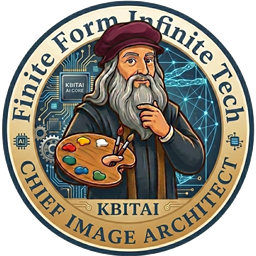
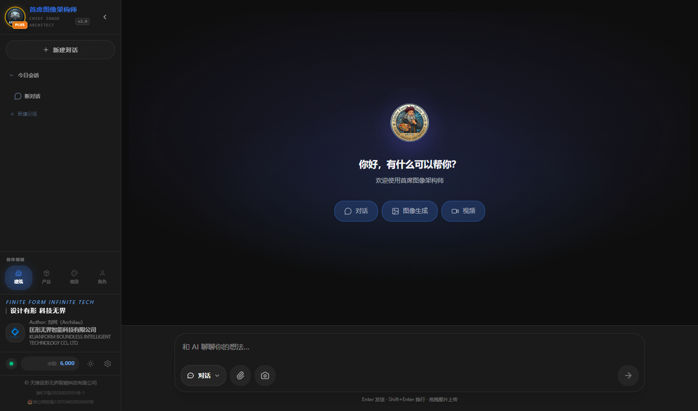
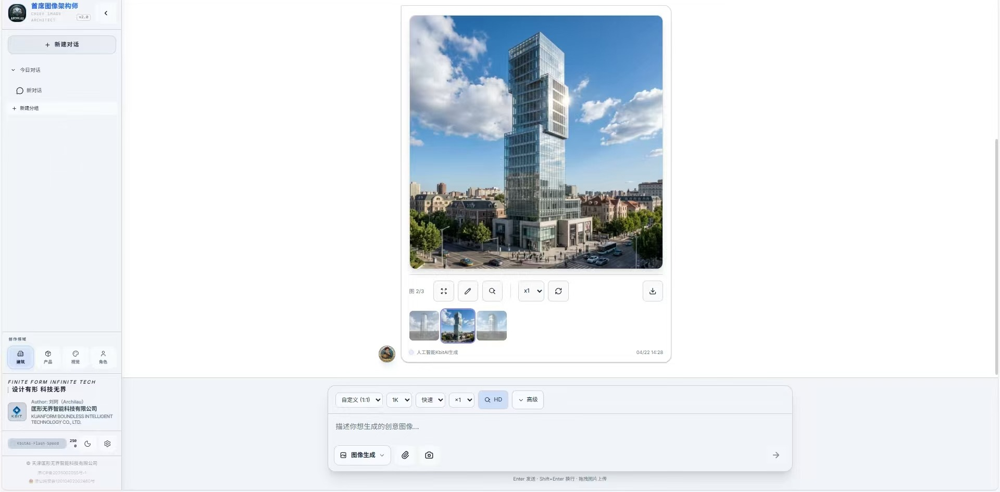
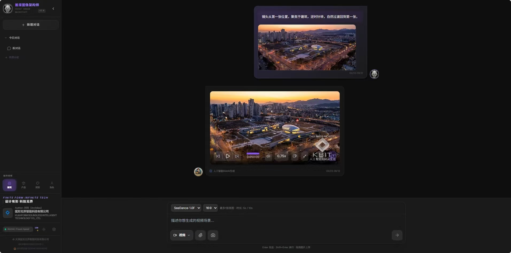
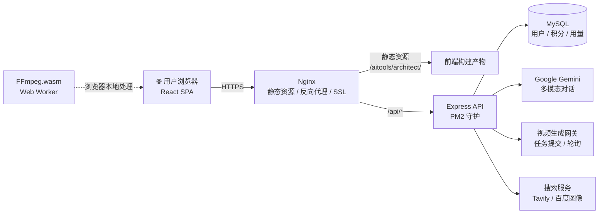

<div align="center">



# 首席图像架构师 · Chief Image Architect

**一站式 AI 视觉创作工作台 —— 对话、生图、视频，一个工作台全部完成**

简体中文 ｜ [English](README.en.md)

<br />


</div>

---

`首席图像架构师` 是一个面向内容创作者的 **AI 视觉创作工作台**，把智能对话、AI 图像生成与编辑、AI 视频生成整合进统一的深色高端界面。图像 EXIF 水印与浏览器端 FFmpeg 视频水印保障作品版权；邀请码、积分套餐与管理后台构成完整的商业化闭环。

## 📸 产品预览

<div align="center">

</div>

| 图像生成与编辑 | AI 视频导演台 |
| :---: | :---: |
|  |  |

> 更多截图见 [`DOCS/images/`](DOCS/images/)。

## 📑 目录

- [核心特性](#-核心特性)
- [技术栈](#-技术栈)
- [快速开始](#-快速开始)
- [项目结构](#-项目结构)
- [系统架构](#-系统架构)
- [环境变量](#-环境变量)
- [部署文档](#-部署文档)
- [路线图](#-路线图)
- [常见问题](#-常见问题)
- [版权声明](#-版权声明)

## ✨ 核心特性

### 🎨 首席图像架构师
- **AI 图像生成**：基于大模型的文生图 / 图生图，支持风格化提示词
- **局部重绘（Inpaint）**：涂抹区域即可重绘，精准修改画面局部
- **截图裁剪**：内置截图与裁剪工具，快速取材再创作
- **风格迁移**：参考图风格一键迁移
- **版权水印**：写入 EXIF 元数据 + 可视水印（`piexifjs`），保障作品归属

### 💬 AI 对话
- 基于 **Google Gemini**（`@google/genai`）的多模态对话
- **联网增强**：海外 Tavily 搜索 + 国内百度图像搜索双通道
- 图像理解与分析，对话结果可直接流转到生图 / 视频模块

### 🎬 动漫导演控制台
- **AI 视频生成**：经后端网关提交任务、轮询进度、自动恢复
- **浏览器端视频处理**：`FFmpeg.wasm` + Web Worker，视频加水印不占服务器算力
- 视频结果持久化，刷新 / 切换页面后自动从服务端恢复播放

### 🏢 平台能力
- 邀请码注册、登录鉴权、密码重置
- 积分 / 套餐计费、用量统计、在线支付
- Beta 申请审核与独立管理后台

## 🛠 技术栈

| 分层 | 技术 |
| --- | --- |
| 前端框架 | React 19、TypeScript 5.8、Vite 6 |
| 状态与样式 | Redux Toolkit、Tailwind CSS 4、lucide-react |
| 浏览器能力 | FFmpeg.wasm、Web Worker、piexifjs、Canvas / Blob |
| AI 能力 | Google Gemini（`@google/genai`）、第三方视频生成网关 |
| 后端 | Node.js (≥18)、Express、MySQL 5.7+、PM2 |
| 运维 | Nginx 反向代理、Let's Encrypt SSL、宝塔面板 |

## 🚀 快速开始

### 环境要求

- Node.js ≥ 18
- npm ≥ 9（或 pnpm / yarn 等价命令）
- MySQL 5.7+（仅本地运行后端时需要）

### 前端

```bash
# 1. 安装依赖
npm install

# 2. 启动开发服务器（默认 http://localhost:3000/aitools/architect/）
npm run dev

# 3. 类型检查
npm run lint

# 4. 生产构建（产物输出至 dist/）
npm run build

# 5. 本地预览构建产物
npm run preview
```

> 开发环境下接口统一经 Vite 代理转发，无需本地启动后端即可联调（详见
> [`vite.config.ts`](vite.config.ts) 中的 `server.proxy`）。

### 后端（可选）

```bash
cd backend
npm install
cp .env.example .env   # 按下文「环境变量」填写
mysql -u root -p < database.sql   # 导入数据库
npm start              # 或使用 PM2：pm2 start ecosystem.config.js
```

## 📂 项目结构

```
.
├── App.tsx                  # 应用入口与三大模块调度
├── index.tsx                # React 挂载
├── components/              # UI 组件（图像生成、重绘、视频、对话等）
├── services/                # 业务服务层（AI、水印、API、用量、视频等）
├── src/
│   ├── store/               # Redux Toolkit 状态（各 slice）
│   ├── hooks/               # 自定义 Hooks
│   ├── config/              # 套餐等前端配置
│   └── styles/              # 全局样式
├── legal/                   # 隐私政策与服务条款
├── i18n/                    # 多语言文案
├── vite.config.ts           # Vite 构建与开发代理配置
├── backend/                 # Express 后端
│   ├── server.js            # 服务入口
│   ├── routes/              # 路由（鉴权、视频网关、支付、用量等）
│   ├── controllers/         # 控制器
│   ├── services/            # 服务层
│   ├── middleware/          # 中间件
│   └── ecosystem.config.js  # PM2 配置
├── database/                # 数据库脚本
├── deploy/                  # Nginx 等部署配置参考
└── DOCS/
    ├── DEPLOY.md            # 完整部署手册
    └── images/              # README 截图素材
```

## 🏗 系统架构



- **前端纯静态部署**，Nginx 按子路径发布并回退到 `index.html`（SPA 路由）
- **敏感密钥只存在于后端**，前端永远不直接持有第三方 API Key
- **视频水印在浏览器内完成**，服务端只负责任务编排与结果存储

## 🔧 环境变量

后端通过 `.env` 配置（参考 `backend/.env.example`）：

| 变量 | 说明 |
| --- | --- |
| `DB_HOST` / `DB_PORT` / `DB_DATABASE` | MySQL 连接信息 |
| `DB_USERNAME` / `DB_PASSWORD` | 数据库账号 |
| `JWT_SECRET` | 登录令牌签名密钥（请使用随机长字符串） |
| `ENCRYPTION_KEY` | 敏感字段加密密钥（32 字符） |
| `PH8_API_KEY` / `PH8_GATEWAY_KEY` | 视频生成网关凭证 |
| `TAVILY_API_KEY` | 海外联网搜索 |
| `BAIDU_APP_ID` / `BAIDU_API_KEY` / `BAIDU_SECRET_KEY` | 百度图像搜索 |

> ⚠️ 请勿将真实 `.env`、密钥或生产数据库提交到仓库。

## 📦 部署文档

完整的服务器要求、Nginx 配置、PM2 守护、SSL 证书与故障排查，请参阅：

**👉 [DOCS/DEPLOY.md](DOCS/DEPLOY.md)**

## 🛣 路线图

- [ ] 图像批量生成与任务队列
- [ ] 更多视频风格模型接入
- [ ] 作品云端画廊与分享页
- [ ] 水印强度与样式自定义

## ❓ 常见问题

**Q：`npm run dev` 后接口报跨域 / 证书错误？**
A：开发环境所有接口走 Vite 代理，请使用 `http://localhost:3000/aitools/architect/`
或局域网 IP 的 3000 端口访问，不要直接打开构建产物。

**Q：生产环境 502 Bad Gateway？**
A：依次检查 PM2 进程（`pm2 list`）、后端端口、Nginx 反向代理配置，详见
[部署文档](DOCS/DEPLOY.md)。

**Q：FFmpeg.wasm 首次加载较慢？**
A：核心文件约 30MB，仅在首次进入视频功能时按需加载，之后由浏览器缓存。

## 📄 版权声明

本项目代码与资源版权归 **天津匡形无界智能科技有限公司** 所有，保留所有权利（All Rights Reserved）。

未经书面授权，禁止用于商业再分发。技术交流与问题反馈欢迎提交 Issue / Pull Request。

<div align="center">
<br />
<sub>Built with ❤ by Kbit AI</sub>
</div>
